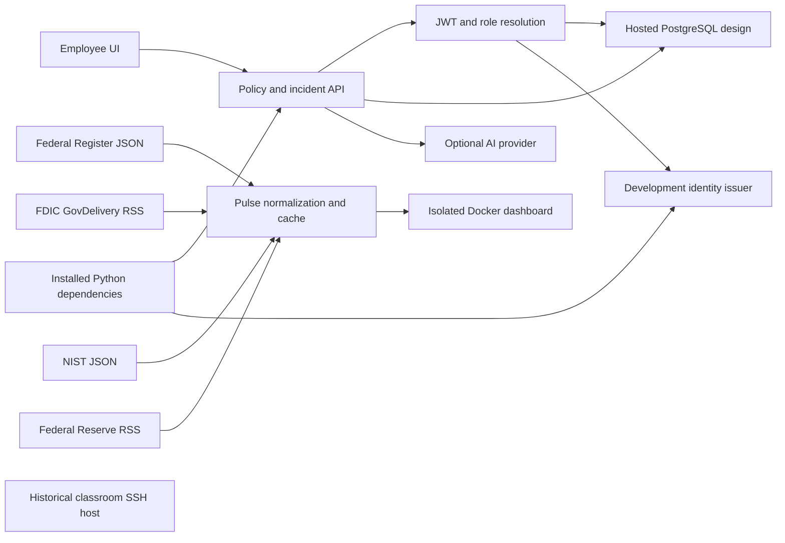

# Asset inventory, relationships and business impact

[assets.json](assets.json) is the approved local register. It records stable identifiers, accountable functions, classification, criticality, evidence and dependency edges. Fourteen component records are catalogued. Thirteen comprise the application/lab ecosystem and one is a historical classroom host. Package instances are counted separately to avoid inflating asset coverage.

Source inspection verifies component definitions and relationships. Prior Docker inspection verifies one historical running lab configuration. Hosted database and provider deployment states are untested in this assessment. The JSON inventory includes evidence type for each record.

| Boundary | Business impact if compromised | Assessment basis |
|---|---|---|
| UI → API → policy versions | Unauthorized approval can change employee guidance and incident instructions. | Signed API fixtures and direct handlers |
| Identity → database role lookup | Incorrect mapping can cross role or private-record boundaries. | Real development-token verifier with synthetic server-side rows |
| API → hosted DB | Service credentials can grant broader access than employee roles. | Source/design only, no live access |
| Optional AI provider | Policy context could leave the application boundary. | Source contract only, no provider request |
| Publishers → Pulse → browser | Wrong source attribution can make untrusted guidance appear authoritative. | Synthetic hostile URL check and prior live records |
| Container → localhost | Exposed or privileged service broadens host attack surface. | Current Compose declaration and reused runtime evidence |
| Packages → API | Dependency changes alter executable behavior and reproducibility. | Installed versions/relationships and pip consistency |
| Historical SSH host | Remote administration is a potential privileged entry point. | Prior Nmap report only |

The prior Nmap report recorded 10 active hosts on 10.11.2.0/24 and TCP/22 on 10.11.2.144, with 65,534 TCP ports closed. No target-specific CVE was confirmed. Only 1 of 10 historical hosts has detailed service evidence here. These counts are not part of the current application assessment denominator. Raw XML, other host identities and current reachability remain unavailable.

Review critical upstream nodes first. Authentication and policy writes can affect the full guidance workflow, while individual publisher loss is isolated by the feed cache. External relationship edges describe data flow, not proof of connectivity today.
