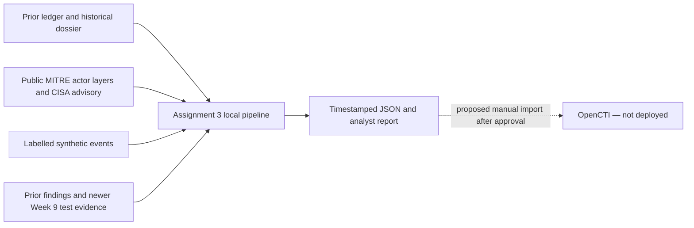

# How the local lab works

## Architecture

This is a local command, not a server or replacement DeRexi feature. It never imports
FastAPI, database code or credentials. `src/intel_ops.py` writes only inside this
assignment and refuses an existing run folder. No code, logs or temporary test
files are written beside the prior ledger; bytecode writes are disabled.

## Reused capabilities and boundaries

[Prior CT+V 2 intelligence analysis](<../../CT+V 2 Assignment 5/03-intelligence-operations.md>)
already defines requirements, source caveats and indicator workflows. The existing
[ledger](<../../CT+V 2 Assignment 5/intel-ledger.py>) is loaded and its `reconcile()`
function is called, preserving its hash normalization/deduplication and source lists.
The [original k.php dossier](<../../../cyber_threats_and_vulnerabilities_1/CT+V Assignment 1/Malware_Analysis_Threat_Dossier_k_php.pdf>)
provides the historical first-seen date; there is no new malware execution.

[Pulse source code](../../../derexi-policy-pilot/backend/pulse/sources.py) supplies
an existing example of bounded public collection. Pulse remains a regulatory feed,
not an actor/IOC TIP. This assignment does not edit its code or UI. Concurrent Pulse source changes were
detected after inspection; [the drift record](../evidence/concurrent-source-drift.json)
limits the audit to the versions originally hashed. Later revisions were not tested here. [Prior Docker evidence](<../../CT+V 2 Assignment 5/docker-evidence/README.md>)
proves a Windows Pulse container only. Current Mac discovery finds no Docker CLI or
OpenCTI listener. The [reuse inventory](../evidence/reuse-inventory.json) records
source hashes and limitations without copying those artifacts. Some older reports
contain former folder names; this package uses current relative paths.

## Collection and analysis

`--collect` reads two fixed official MITRE Navigator JSON layers and the CISA
FASTCash PDF over HTTPS. A 12-second timeout, 2 MB response ceiling, refused redirects,
actor/domain binding and technique-ID validation constrain collection. URLs cannot
be supplied on the command line. Each successful response is saved with retrieval
time, size and SHA-256; failures are visible and isolated. The PDF is retained as
analyst source material, not automatically interpreted or executed.

The latest layers contain 151 APT38 and 93 FIN7 technique entries. Scenario mappings
use five IDs; all five appear in APT38 context and four also appear in FIN7 context.
That overlap demonstrates why generic PowerShell/service behavior cannot establish
actor identity. These are behavior-context links, not attribution relationships.
Names and ATT&CK IDs in the synthetic fixture are analyst mappings, not a detector
that infers maliciousness from raw Windows logs.

## Campaign workflow

1. Keep public FASTCash reporting, the fictional DeRexi tabletop and the historical
   k.php dossier as three separate cases. Never merge cases simply because both
   concern banking or malware.
2. Validate event identity, timestamp, host, case and the explicit simulation label.
   Repeated identical events are deduplicated; conflicting IDs are rejected.
3. Sort by UTC time. Alert only when PowerShell precedes a service event on the same
   host and case within 30 minutes. Windows Event IDs 4104/7045 are proposed future
   sensor sources; this run uses labelled JSON events, not real Windows logs.
4. Review the alert with its two contributing event IDs. The high research priority
   means investigate, not isolate a machine automatically. Attribution stays unknown.

Tests cover cross-host/case separation, wrong order, stale windows and duplicate
input. One positive and three negative hosts are labelled by fixture design. The
result measures repeatable rule behavior only; real attacker coverage is untested.

## Indicator lifecycle and decisions

Collect → quarantine → validate/normalize → deduplicate → assess provenance → review
→ approve a scoped hunt or suppress → expire/review → report corrections. Hash review
is due after 90 days; infrastructure after 14 days. These are **lab policy choices**,
not universal expiry standards. Time is measured from the historical observation,
not today's collection. No fresh sightings or confidence are fabricated.

E02 and E05 both describe the same dossier, so two source labels count as one
independent family. Confidence 70/100 is an explicit training assessment, not a
vendor score or attribution confidence. It is not boosted by duplicate reports.
All indicators prohibit enforcement; URLs stay defanged and are never contacted.

`review_indicator()` requires analyst, reason and time and returns a new record
with audit history. Actions: approve a research hunt, revoke, or mark false positive.
Expired/revoked/false-positive records cannot be approved without new evidence and
separate reassessment. Existing input records remain immutable. These transitions
were tested with **simulated analyst decisions**, not performed by a bank analyst.
There is no autonomous blocklist, deletion or sharing to third parties.

## Prioritization and fusion

The pipeline combines four evidence families: historical IOCs, fresh public actor
context, simulated events and retained vulnerability/control evidence. It references
five old findings and their likelihood×impact scores. These are historical priorities,
not a fresh vulnerability scan or proof of exploitability. Newer passing policy/version
write-denial tests downgrade the old policy-write finding to
`superseded_in_newer_isolated_tests`; production closure is not asserted. Remaining
findings require current validation. The application itself is never changed.

Output includes source collection records, indicators, mapped events, campaigns,
actor context, prioritized findings, source hashes, metrics and a Markdown report.
Metrics cover collection successes/failures, input/unique indicators, duplicate ratio,
provenance completeness, expiry, cases/events/alerts, processing time and labelled
TP/FP/FN/TN. Real time-to-triage, sighting prevalence and false-positive rates remain
unknown. Output is a lab JSON contract, **not a validated STIX/OpenCTI import bundle**.

## Tests and limitations

[32 tests pass](../evidence/test-results-20261110T210129262284Z.json), including invalid,
oversized and redirected collection; lifecycle controls; correlation boundaries;
output containment; source independence; stale finding reconciliation; and honest
failed/offline collection. [Five platform checks are blocked](../evidence/platform-acceptance-results.json).
Artifact validation recorded 7 PASS / 1 FAIL: the unchanged-source check detected
concurrent Pulse edits, while final pipeline/test input hashes still matched. That
failed check is preserved, not relabelled as a pass.
No enterprise ingestion service, scheduler, sensor integration or platform access
control was deployed. The chosen correlation rule has a tiny, hand-labelled benchmark.
Live-source availability can change. Hashes detect later artifact changes, not source
truth. Read [the deployment/validation plan](opencti-validation-plan.md) before requesting
approval for any runtime changes.
