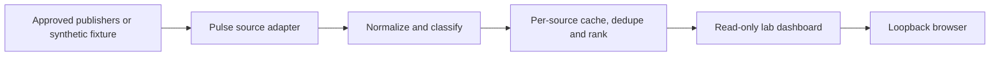

# Assignment 5 | Platform Development & Integration

## Architecture and evidence



The existing Pulse feature handles Federal Register, FDIC, NIST and Federal Reserve inputs, caps responses, normalizes dates and URLs, classifies content and degrades per source. E09 includes earlier integration and browser evidence. The new lab dashboard uses the existing normalization and cache logic. It displays per-source health/count bars, unique normalized count and category totals for the display window. Source counts precede cross-source deduplication. Fixture mode supplies one synthetic Federal Register response and simulates three failures. This panel runs independently of DeRexi credentials and database.

## Install and verify

Run from the repository root with Python 3.12 or the existing project venv:

```powershell
python cyber_threats_vulnerabilities_2_final/dashboard.py --self-test
python cyber_threats_vulnerabilities_2_final/dashboard.py
```

Open `http://127.0.0.1:8080/` and verify the fixture label, one normalized article, three unavailable sources and bars. `/healthz` verifies process liveness. Docker execution was completed on November 9, 2026 using the existing Compose configuration. Exact commands and results are in [Docker evidence](docker-evidence/README.md). The earlier standalone commands remain available:

```powershell
docker version
docker build -f cyber_threats_vulnerabilities_2_final/Dockerfile -t derexi-pulse-lab .
docker run --rm derexi-pulse-lab --self-test
docker run --rm --name derexi-pulse-lab --read-only --cap-drop ALL --security-opt no-new-privileges -p 127.0.0.1:8080:8080 derexi-pulse-lab
```

Run `docker inspect derexi-pulse-lab` and record only user, port mapping, read-only state and image digest. Record build and self-test logs and capture the dashboard after confirming both routes. Docker Desktop is now installed, and the Compose lab built and reached healthy status. The image is specified by a moving minor tag. Pin a reviewed digest before promotion.

## Security settings and operating procedures

Build context is allowlisted. The image runs as a numeric non-root user. Publish on host loopback only and keep the read-only and capability settings. The dashboard escapes data and disallows scripts or framing. Keep the fixture mode for grading and test only within the authorized environment. Where approved, append `--live` to the process or container command to read the configured publishers. Allow only approved publisher egress, verify HTTPS and collect evidence of actual source statuses and normalized counts. Review redirect and publisher host binding before deployment. No Supabase secrets, mounts or persona data are needed.

Daily in live mode, inspect source freshness and counts. Investigate empty/stale sources by confirming publisher reachability and format from an approved host. Treat totals as partial during failures. Update configuration in source with review, run offline regression and fixture health, stage the new image, and retain the previous digest for rollback. Restart clears the in-memory cache. Stop the lab with Ctrl+C or `docker stop derexi-pulse-lab`.

**Exact rubric requirements satisfied:** feed integration/data flow for scoped local and historical Pulse evidence, analytics metrics and visualizations, architecture, configuration and operating instructions. Docker build, startup, health, effective runtime security settings and current feed retrieval are now verified for the isolated Pulse platform.

**Existing evidence reused:** E09 and E10. Assignment 3 separately covers the proposed OpenCTI deployment.

**New tests performed:** Offline Pulse passed 97/97. Fixture normalization, simulated publisher failure and output escaping passed. Both loopback HTTP routes returned 200 with expected metrics and CSP. See [local validation](local-validation.txt) and [HTTP evidence](http-and-controls.txt).

**Remaining limitations:** The deployed image is the standalone Pulse lab. Full policy/persona API deployment and OpenCTI are outside its scope. The tested image ID is recorded. The base tag remains movable. Enterprise egress enforcement and publisher redirect binding were not validated. Additional presentation screenshots are listed in the Docker evidence README.

**Evidence completion review:** See [failure classification, fresh evidence and manual requirements](completion-matrix.md). New results are preserved under followup/. JWT foundation passed 24/24 and five schema checks passed. Installed package metadata covers 35 local distributions. These checks apply to their stated local scope. The newer Docker execution below supersedes the prior Assignment 5 runtime blocker.

## November 9 Docker execution

Compose project derexi-ctv2 launched pulse-lab successfully and reported healthy. All 14 runtime checks passed. They verify non-root UID 65532, zero effective capabilities, no-new-privileges, read-only root, no database configuration/module, HTTP health/dashboard success, CSP, fixture metrics and simulated source failures. Container inspection confirms zero mounts and host binding 127.0.0.1:8080.

A separate process inside the same container retrieved all four live publishers successfully. Federal Register returned 38 normalized records, FDIC 25, NIST 9 and Federal Reserve 15. The combined feed contained 87 unique normalized items and returned a 40-item default window. HTTPS and uniqueness checks passed. The dashboard continues to show one synthetic item and three explicitly simulated failures.

See [execution evidence and screenshot instructions](docker-evidence/README.md), [actual dashboard screenshot](docker-evidence/dashboard-synthetic.png), [security summary](docker-evidence/security-summary.json) and [feed response](docker-evidence/container-feeds.json).

**Status: COMPLETE for the isolated Pulse platform scope.** Instructor acceptance of this platform scope determines the rubric award.


