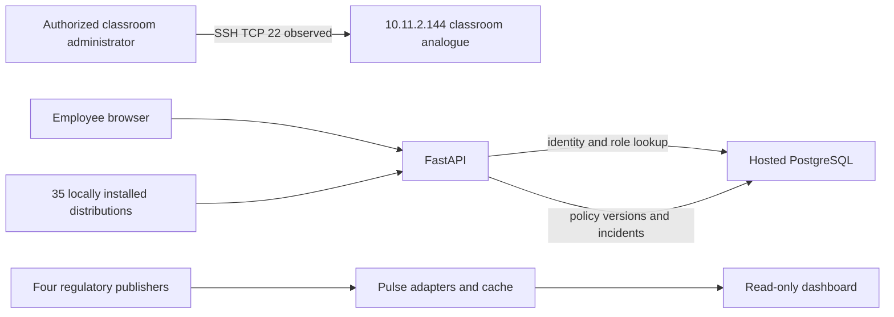

# Asset relationships and remediation

Evidence combines prior authorized classroom Nmap findings with current code inspection. No new subnet scan was performed.

Classroom discovery reported 10 active hosts, but only the selected host has service evidence in this package. Inventory detail coverage is therefore 1/10 for that historical population. Current production asset coverage is unknown. The classroom host has no verified connection to the live hosted database. Diagram edges outside the classroom are code/design relationships.

P0 — Policy write authorization. Signed Employee token received approval success in isolated fake-session testing. Owner approval also needs explicit administrator-only acceptance criteria before release.
P1 — Retest private-object access with signed identities and a disposable relational fixture. Prior unsigned denials do not establish isolation.
P1 — Collect deployed SBOM and advisory assessment. Local pip check validates dependency consistency only.
P2 — Reconcile all discovered assets, ownership and administration ACL evidence.

Track closure only after independent negative tests. No remediation SLA achievement or production vulnerability coverage is claimed.
