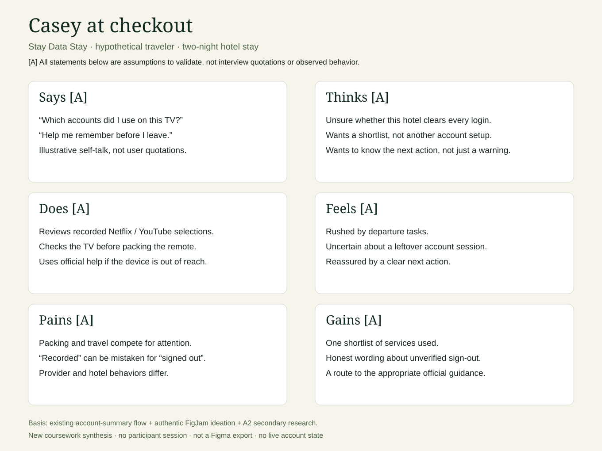

# Assignment 1 · Empathy map

**Status: COMPLETE as an assumption-labelled design synthesis. No interview or
observed participant session is claimed.**

## User and experience

**Casey**, an illustrative traveler, is checking out after a two-night hotel stay
and wants to review accounts used on shared accommodation devices. Name, duration,
departure pressure, behavior and emotions are **assumptions [A]**. They are a design
hypothesis, not a demographic finding or an existing interviewed persona.

## Completed map

| Region | Hypothesized experience [A] |
|---|---|
| Says | “Which accounts did I use on this TV?”; “Help me remember before I leave.” These are illustrative self-talk, not quotations from research. |
| Thinks | Unsure whether a particular hotel clears every login; wants a shortlist rather than another account setup. |
| Does | Reviews recorded services, checks the TV and seeks official help when a device is out of reach. |
| Feels | Rushed, uncertain about a leftover session, then reassured by a clear next action. |
| Pains | Departure tasks compete for attention; “Recorded” can sound like “signed out”; providers and hotel setups differ. |
| Gains | A shortlist, honest status wording and a route to the appropriate official instructions. |

## Existing evidence and design implications

- **E1:** [Existing Design 1 program](../stay_data_stay.py), lines 180–205 and
  287–307, offers account selection and a summary. This establishes an available
  task flow, not proof of Casey's actual behavior.
- **E2:** [Original FigJam preview](../assignment_05_conversational_prototype/original-figjam-thumbnail.png)
  and [source archive](../../figma_1/Stay%20Data%20Stay.jam) document earlier project ideation.
- **E3:** [Research](../assignment_02_documented_research/research.md) supports
  service-specific guidance; it does not establish the hypothesized emotions.

The design response is a short account list, explicit limits on sign-out certainty
and optional guidance. Some supported Netflix hotel systems clear information at
checkout; Casey's uncertainty must not become a claim that all hotel logins persist.

## Verify / next research

The SVG and content are newly authored coursework, not a Figma export. Local checks
verify all six regions and assumption labels. To validate the persona later, ask a
consenting traveler to explain a recent checkout experience without sharing account
credentials, then revise the map from actual observations.

- [x] Specific user/experience; Says, Thinks, Does, Feels, pains and gains.
- [x] Completed visual, existing evidence and explicit assumptions.
- [x] No invented interviews, quotations or observed outcomes.

[Course evidence and validation](../README.md).
