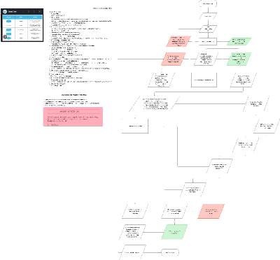

# Assignment 5 · Conversational prototype

**Status: COMPLETE as a presentation-ready prototype packet. Participant session:
NOT RUN; feedback and usability outcomes: NOT COLLECTED.**

## Purpose statement — verbatim from Assignment 3

Stay Data Stay is a checkout checklist for travelers who use shared accommodation devices. It is designed to help them remember which accounts they accessed and review sign-out actions before leaving, without collecting service passwords or claiming to sign accounts out automatically.

## Research summary

[A2](../assignment_02_documented_research/research.md) reviewed three primary publishers:
Netflix describes clearing for supported hotel systems; Google explains provider
session management; Smartraveller recommends preventive sign-out practices.
These support honest status wording, a manual shortlist and separate official-help
guidance. They do not establish user demand or effectiveness. Provider details and
scope are recorded in A2; no interviews were conducted.

## Visual evidence and provenance

The preview above is extracted byte-for-byte from
[Stay Data Stay.jam](../../figma_1/Stay%20Data%20Stay.jam). It is authentic existing
FigJam ideation, not a new editor screenshot or evidence of a native Design frame.
[Original metadata](original-figjam-metadata.json) records export context, not a
new creation date. At 400×372 the thumbnail is context, not the legible main demo.

The main visual is reused unchanged from
[the existing Figma 1 import kit](../../figma_1/assignment_1_frames/stay-data-stay-frame.svg).
It is a 1440×960 **concept SVG**, not a live app, native Figma frame or tested clickable
prototype. Its embedded branding is existing repository artwork. Three service
rows and the reminder panel demonstrate the purpose without showing real accounts.
“Recorded” means selected for a fictional stay, not signed out. The displayed
two-night stay and account selections are synthetic.

## Facilitator setup

Open the SVG in a browser or image-capable viewer and keep this script beside it.
Say that this is a static concept: participants may point or describe actions, but
the drawn rows do not click, connect accounts or send reminders. Use only fictional
account examples. Do not request credentials, real device access or personal travel
details. Allow the participant to skip questions or stop; record only agreed feedback.

## Conversational walkthrough — planned script

| Step / visual focus | Presenter prompt | What to listen for / honest follow-up |
|---|---|---|
| 1 · Purpose and scenario | “Imagine Casey is leaving after a two-night stay. What would you want to check before departure?” | Listen before mentioning accounts; the departure-pressure assumption may be wrong. |
| 2 · Account list | “Looking at these three rows, what do you think this product remembers?” | Ask the participant to explain in their own words; do not supply a success answer. |
| 3 · Recorded label | “What does ‘Recorded’ mean to you? Does this screen tell you whether Netflix is signed out?” | If they assume verified logout, explain that this concept stores a selection only. Note the misunderstanding as actual feedback only if observed. |
| 4 · Reminder panel | “What would you do next to finish checking your accounts?” | The reminder communicates intent, not a delivered notification. Ask how a cue could fit their real routine. |
| 5 · Already left the device | “If you were already on the way home, what help would you need?” | Discuss official provider guidance as an unbuilt idea. No recovery button or automatic logout is present in this visual. |
| 6 · Revision and alternatives | “What is missing or confusing? Would a physical departure cue or a recovery guide fit better?” | Compare A4 alternatives without treating a hypothetical response as a measured preference. |
| 7 · Close | “What would you change first, and why?” | Recap the participant's actual words, ask permission to retain notes, then separate observation from interpretation. |

### Exception prompts

- If a participant expects every hotel to retain access, clarify that supported
  integrations can behave differently; the checklist is not a session detector.
- If they expect real controls, restate that this is a static visual and ask them to
  describe the intended action. Mark missing controls as design gaps, not tested features.
- If they offer credentials, stop that disclosure and return to fictional examples.

## Recording and evaluation plan

Use [feedback-form.md](feedback-form.md). Planned observations: whether the person
can explain the list, distinguish selection from sign-out, and identify a next action.
These are questions to investigate, **not completed tests or numeric success metrics**.
No participant response, screenshot of a session or usability pass is fabricated.

- [x] A3 purpose statement included unchanged.
- [x] A2 research summarized with source traceability.
- [x] Authentic existing FigJam context plus a legible reused product visual.
- [x] Conversational script, exception prompts and honest feedback collection plan.

Human feedback is a next design activity; the supplied rubric asks for a prototype
and walkthrough, not a completed participant study. [Course index](../README.md).
