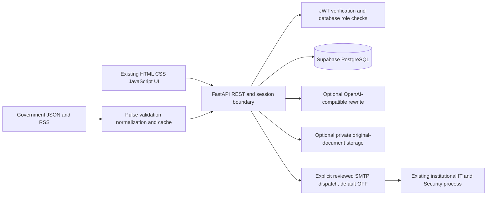
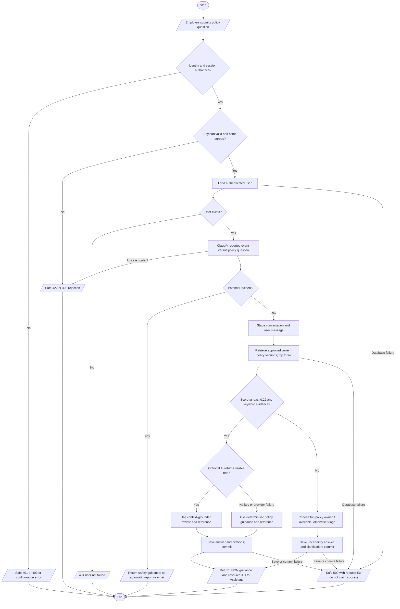

# DeRexi: Policy Pilot
## Master Design Document · Version 1.0

**Author:** Kiona Wilson · **Review date:** 2026-11-23 · **Context:** fictional
Aurum Capital Bank, Lending and Wealth Management. **Canonical application:**
`derexi-policy-pilot/`. This self-contained document covers all 13 supplied criteria;
the 12 supporting assignments expand individual submission requirements.

## 01 · Design basis, evidence and boundaries

Use the existing application and evidence, not the full set of technologies imagined
in the original proposal. **Implemented** denotes inspected code; **tested** names
a dated result/environment; **planned** is a proposal; **unverified** is a missing
measurement/acceptance proof. Local fixture success does not establish production
readiness, real email delivery, ticket creation, regulatory compliance or human UAT.

The source-of-truth order is current scoped code/catalog evidence for implementation,
dated machine results for execution, then reports/plans for intent. Later evidence
only supersedes an earlier observation within the scope actually rechecked. Thus
the Nov 23 core PostgreSQL check cannot close Nov 12 Auth/Governance/support gates,
and an old persona diagram or Week 6 save confirmation cannot override later role
code or persisted-feedback defect evidence. [S03 · README.md](../../derexi-policy-pilot/README.md) [S17 · test-report.md](../../semester_5/DeRexi_Week%2010/test-report.md) [S19 · final-summary.json](../../semester_5/DeRexi_Week%2011/evidence/final-integration-20261112/final-summary.json) [S20 · live-readonly-preflight.json](../../semester_5/DeRexi_Week%2011/evidence/final-integration-20261112/live-readonly-preflight.json) [S21 · live-readonly-20261123.json](../../postgresql_1/evidence/live-readonly-20261123.json) [S32 · Meet the DeRexi Users.pdf](../../derexi-policy-pilot/design/Meet%20the%20DeRexi%20Users.pdf)

All application test counts below are retained observations, not newly executed
tests. This course package performs only file/document/diagram-structure checks.
No application, database, roles, users, secret configuration or other coursework is
changed; no API calls, deployment, commit or push is performed.

## 02 · Project Summary

DeRexi: Policy Pilot is a policy-governance and incident-assistance application for
employees, Policy Owners and System Administrators at the fictional Aurum Capital
Bank. It connects employee questions to approved, versioned guidance, records
uncertainty for human clarification and provides an independently reviewed policy
maintenance workflow. Its importance is the intended reduction of unclear guidance,
unowned questions and fragmented response handoffs; no measured business time-saving
or compliance-certification claim is made. [S03 · README.md](../../derexi-policy-pilot/README.md) [S24 · employee-guide.md](../../semester_5/DeRexi_Week%2011/employee-guide.md) [S25 · policy-owner-guide.md](../../semester_5/DeRexi_Week%2011/policy-owner-guide.md) [S26 · system-admin-guide.md](../../semester_5/DeRexi_Week%2011/system-admin-guide.md)

### Scope and delivery state

The existing Python/FastAPI and vanilla-web application is the final-project
implementation. Isolated tests support core workflows; production authentication,
Governance/support schema activation and live human acceptance remain unverified.
The original design proposed ticket creation and several alternative technologies;
the current build provides internal references and a disabled-by-default SMTP
adapter, not an activated ticketing integration. [S01 · EDU_Project_Design_Doc_Final V.1.docx](../../semester_2/EDU_Project_Design_Doc_Final%20V.1.docx) [S18 · final-integration-results.md](../../semester_5/DeRexi_Week%2011/final-integration-results.md) [S23 · final-integration-approval-checklist.md](../../semester_5/DeRexi_Week%2011/final-integration-approval-checklist.md)

This submission documents existing work. It does not rebuild features, deploy the
application, change live data or rerun historical tests.


## 03 · Problem Statement

### Banking and fintech context

A lending or wealth-management employee may need a policy answer while handling
customer information, completing a process or reporting a suspicious event.
Policies distributed across documents and owners create practical ambiguity:
which version is approved, who can clarify it, whether an answer applies, and
which security channel should receive a report. DeRexi's original design identifies
this policy-governance information gap; the implemented domain is the fictional
Aurum Capital Bank. No real customer incident or quantified industry statistic is
used as evidence. [S01 · EDU_Project_Design_Doc_Final V.1.docx](../../semester_2/EDU_Project_Design_Doc_Final%20V.1.docx) [S22 · database-design.md](../../semester_3/DeRexi_Week%203/database-design.md) [S03 · README.md](../../derexi-policy-pilot/README.md)

### Problem to solve

Employees need source-backed guidance without guessing. Owners need visible,
traceable clarification and review work. Administrators need controlled publication
and scoped oversight while protecting staff conversations and draft policy data.
A generic generated answer or a negative-feedback counter alone does not provide
an accountable policy decision. [S24 · employee-guide.md](../../semester_5/DeRexi_Week%2011/employee-guide.md) [S25 · policy-owner-guide.md](../../semester_5/DeRexi_Week%2011/policy-owner-guide.md) [S26 · system-admin-guide.md](../../semester_5/DeRexi_Week%2011/system-admin-guide.md)

### Design response and limits

Use approved policy versions and lexical retrieval with an evidence gate, retain
citations, route uncertainty to an owner/triage, persist feedback and messages,
and require independent review before publication. Incident intake must request
employee review and consent; the normal institutional incident channel remains
essential for urgent response. The app assists governance; it does not grant policy
exceptions, certify regulatory compliance or replace investigation/ticket resolution.
[S04 · main.py](../../derexi-policy-pilot/backend/main.py) [S07 · governance.py](../../derexi-policy-pilot/backend/governance.py) [S08 · incident_assistance.py](../../derexi-policy-pilot/backend/incident_assistance.py) [S14 · messaging.py](../../derexi-policy-pilot/backend/messaging.py)

### Boundary

The intended benefit is better access, accountability and consistency. Actual
productivity improvement, representative answer accuracy and production rollout
need measured acceptance evidence; current fixture passes do not establish them.
[S17 · test-report.md](../../semester_5/DeRexi_Week%2010/test-report.md) [S18 · final-integration-results.md](../../semester_5/DeRexi_Week%2011/final-integration-results.md)


## 04 · Users and Use Cases

### Roles and interaction needs

| User/role | Need | Interaction with existing DeRexi | Evidence boundary |
|---|---|---|---|
| Employee; Sam is an illustrative tested profile | Find guidance and get human help when uncertain | Ask a question, inspect reference/Library, rate answer, open own clarification thread and read/reply | Real isolated HTTP/UI; representative retrieval accuracy and live identity unverified |
| Policy Owner; Jordan is an illustrative profile | Resolve assigned questions and maintain department policy | Reply in Messages; edit/import a draft; select an independent same-department peer; address changes | Scoped lifecycle/messages tested locally; live peer capacity/schema activation pending |
| System Administrator; Lucy is an illustrative profile | Oversight without bypassing independent review | Route triage, review incidents, independently approve then explicitly publish; monitor scoped Dashboard | Local role and lifecycle tests; production infrastructure/provider acceptance pending |
| IT/SOC responder or approved routing delegate | Receive actionable, correctly routed support information | Use reviewed internal reference/approved route; investigate in existing institutional system | Delegation grants are separate from business roles; actual email/ticket delivery unverified |

Names above refer to existing fixture/walkthrough examples, not evidence of real
production Auth accounts. The early persona PDF uses different conceptual names/
roles (for example Dana as an Owner and Maya as an employee). It is historical
design material, not the current authorization directory. Database-derived roles
and current workflow evidence take precedence. [S32 · Meet the DeRexi Users.pdf](../../derexi-policy-pilot/design/Meet%20the%20DeRexi%20Users.pdf) [S34 · employee-messages-walkthrough.md](../../semester_5/DeRexi_Week%2011/employee-messages-walkthrough.md) [S06 · security.py](../../derexi-policy-pilot/backend/security.py)

### UC-01 · Employee question to accountable clarification

**Preconditions:** verified employee identity, accessible published-policy database.
**Trigger:** employee submits one policy question without secrets/customer content.
The Assistant returns cited guidance when its lexical/evidence gates pass; otherwise
it stores an uncertainty answer and clarification for the policy owner, or unassigned
Admin triage when no owner is available. The employee follows the Messages link;
the assigned owner replies in the same thread. The result is a recorded answer or
accountable clarification, not permission to make an exception. [S04 · main.py](../../derexi-policy-pilot/backend/main.py) [S14 · messaging.py](../../derexi-policy-pilot/backend/messaging.py) [S24 · employee-guide.md](../../semester_5/DeRexi_Week%2011/employee-guide.md)

Unauthorized people cannot read a private thread; invalid input/session yields a
safe error. H07–H12 in the retained November 18 HTTP evidence support the actual
uncertainty path, persistence and access denials; PostgreSQL search in that fixture
was mocked to no matches. The seven retained browser checks establish actual
display/network behavior, not a new runtime verification. [S28 · http-results.json](../../ai_api_intergration_1/AAI%201%20Assignment%201/evidence/20261118-api/http-results.json) [S29 · browser-results.json](../../ai_api_intergration_1/AAI%201%20Assignment%201/evidence/20261118-api/browser-results.json)

### UC-02 · Owner revision to independent publication

An Owner creates or revises a draft, reviews extracted text if a file was imported,
then submits to an independent eligible department peer. A separate Admin grants
final approval and explicitly publishes on/after the effective date. Saved changes
invalidate approvals; employees continue reading the published version meanwhile.
Self-approval/foreign-department access is denied. Local lifecycle evidence covers
the workflow; live staffing/schema prerequisites remain pending. [S07 · governance.py](../../derexi-policy-pilot/backend/governance.py) [S25 · policy-owner-guide.md](../../semester_5/DeRexi_Week%2011/policy-owner-guide.md) [S38 · README.md](../../semester_4/DeRexi_Week%208/README.md)

### UC-03 · Suspected incident to reviewed support reference

An actual-event question produces immediate safety guidance before retrieval.
Separate support intake collects bounded follow-ups, presents identity/route/details
for employee review, and requires explicit confirmation. Dispatch is a separate
action and defaults OFF; SMTP acceptance is never delivery or ticket creation.
An Admin can triage the internal incident reference. Urgent events use the existing
institutional IT/Security channel immediately. [S08 · incident_assistance.py](../../derexi-policy-pilot/backend/incident_assistance.py) [S26 · system-admin-guide.md](../../semester_5/DeRexi_Week%2011/system-admin-guide.md) [S18 · final-integration-results.md](../../semester_5/DeRexi_Week%2011/final-integration-results.md)


## 05 · Goals and Objectives

The original design aims for sourced guidance, management visibility and escalation.
The following are **proposed measurable acceptance targets**, operationalizing those
goals for evaluation; they are not historical measured achievements. [S01 · EDU_Project_Design_Doc_Final V.1.docx](../../semester_2/EDU_Project_Design_Doc_Final%20V.1.docx)

| Goal | Specific target and expected outcome | Method/owner | Observed versus target |
|---|---|---|---|
| G1 · Grounded, honest guidance | At least 18 of 20 independently reviewed answerable questions cite the correct policy/version; all 10 unsupported questions avoid invented authoritative answers and route for clarification | Compliance/Policy Owners label a synthetic banking question set; record response, citation and routing judgment | Gates/citations/clarification implemented. No representative 20+10-question result is supplied |
| G2 · Accountable clarification with least privilege | All 12 predefined role/ownership cases produce the expected allow/deny result; zero nonparticipant private-thread reads | Admin/security reviewer runs employee/assigned-owner/Admin/nonparticipant matrix and checks saved request/reply history | Existing isolated security/messages evidence passes within its own suites; it is not this new acceptance matrix |
| G3 · Controlled publication | One complete three-actor revision cycle retains the old published version until explicit publication, denies self-approval, and invalidates approval after every saved edit | Owner, independent peer and independent Admin review version/audit outputs in authorized staging | Local lifecycle suite recorded 102 passes. Live publication acceptance is pending |

### Success conditions and non-goals

Targets apply only after the required schema, identity and safe staging environment
are approved. Keep a dated acceptance record; do not convert a design target into
a pass because a feature exists. Institutional compliance certification, autonomous
incident resolution and activated external ticket creation are outside the MVP
claim. [S04 · main.py](../../derexi-policy-pilot/backend/main.py) [S07 · governance.py](../../derexi-policy-pilot/backend/governance.py) [S17 · test-report.md](../../semester_5/DeRexi_Week%2010/test-report.md) [S19 · final-summary.json](../../semester_5/DeRexi_Week%2011/evidence/final-integration-20261112/final-summary.json) [S23 · final-integration-approval-checklist.md](../../semester_5/DeRexi_Week%2011/final-integration-approval-checklist.md)

The evaluation assignment defines measurement detail and additional operational
indicators. No new application tests are executed by this documentation package.


## 06 · Key Features & Functions

### Status language

**Implemented** means present in inspected source; **tested** identifies a specific
retained result and environment. **Planned** means a proposal, not delivered behavior.
**Unverified** means no suitable execution/deployment evidence. A feature can be
implemented and locally tested while remaining unverified in production.

| Feature | Implemented behavior | Tested evidence, retained | Planned/unverified boundary |
|---|---|---|---|
| Policy Assistant + Library | Approved current-version retrieval, score ≥0.22 plus keyword gate, citation/reference, optional rewrite/fallback and browse/detail | Source and local HTTP/UI uncertainty path; prior policy checkpoints | Lexical score is not calibrated probability. Representative PostgreSQL ranking/LLM-answer quality not established by mocked search |
| Answer feedback | POST saves Yes/No rating; repeat rating updates the row; Dashboard exposes authorized aggregates | Week 10 persistence/error/department-scope checks; earlier UI-only save claim superseded | A negative rating does not automatically email an owner, create a ticket or publish a revision |
| Clarification + Messages | Owner/triage routing, scoped replies, notifications, unread/read markers | Retained messages/security/integration suites | Real human response times and production UAT unverified |
| Directory/ownership | Protected `/users`, roles/departments and policy-owner relationships; email returned only to Admin/self | Source authorization and existing role tests; read-only core metadata | A dedicated full directory UI is not established; do not infer user-provisioning/role-editor functionality |
| Governance + document intake | Draft/revision, bounded DOCX/PDF text extraction, independent peer/final approval, explicit publication and history | 102 lifecycle and 47 document checks in retained Nov 12 suites | No OCR or automatic publication scheduler. Latest detailed live readiness observation (Nov 12) found Governance tables absent |
| Incident assistance | Event heuristics, urgent guidance, reviewed follow-ups/consent, internal reference, approved routing and explicit dispatch | 75 support and 17 mocked SMTP/TLS checks, plus isolated browser evidence | Support schema activation, approved real destinations and delivery/ticketing unverified; outbound default OFF |
| Policy Health Dashboard | Role-scoped policy/review/feedback/clarification/incident indicators | Retained scoped feedback/Dashboard integration | Operational visibility is not compliance certification; production metrics/SLAs unmeasured |
| Pulse | Four government feeds: two JSON, two RSS; normalization, classification labels/cache, original source links and source-linked draft/revision handoff | Isolated source-validation tests; Nov 18 public 200 observations and actual UI | Not a threat-intelligence platform or legal adjudicator. No automatic approval/publication; current feed uptime not rechecked |

### Evidence and practical limits

The preserved Nov 10 CT+V audit detected concurrent Pulse source drift. Its
original hashes limit that audit to the inspected revision; later test reports
do not rewrite the historical failed integrity check. This documentation neither
reruns that audit nor declares its drift record cleared. [S41 · concurrent-source-drift.json](../../cyber_threats_and_vulnerabilities_2/CT%2BV%202%20Assignment%203/evidence/concurrent-source-drift.json)

Feature implementation: [S04 · main.py](../../derexi-policy-pilot/backend/main.py) [S07 · governance.py](../../derexi-policy-pilot/backend/governance.py) [S08 · incident_assistance.py](../../derexi-policy-pilot/backend/incident_assistance.py) [S14 · messaging.py](../../derexi-policy-pilot/backend/messaging.py) [S15 · document_intake.py](../../derexi-policy-pilot/backend/document_intake.py) [S36 · app.js](../../derexi-policy-pilot/backend/static/app.js).
Pulse: [S12 · sources.py](../../derexi-policy-pilot/backend/pulse/sources.py) [S13 · service.py](../../derexi-policy-pilot/backend/pulse/service.py). Testing and corrections: [S17 · test-report.md](../../semester_5/DeRexi_Week%2010/test-report.md) [S18 · final-integration-results.md](../../semester_5/DeRexi_Week%2011/final-integration-results.md) [S19 · final-summary.json](../../semester_5/DeRexi_Week%2011/evidence/final-integration-20261112/final-summary.json).
Original UI and HTTP evidence: [S28 · http-results.json](../../ai_api_intergration_1/AAI%201%20Assignment%201/evidence/20261118-api/http-results.json) [S29 · browser-results.json](../../ai_api_intergration_1/AAI%201%20Assignment%201/evidence/20261118-api/browser-results.json).

The November 12 read-only readiness inventory is the latest reviewed observation
about absent Governance/support tables, zero Auth users and incomplete peer-owner
coverage. The later November 23 check verified core tables/counts only and **did
not recheck those missing tables or Auth state**. Do not silently carry either
observation beyond its measured scope. [S20 · live-readonly-preflight.json](../../semester_5/DeRexi_Week%2011/evidence/final-integration-20261112/live-readonly-preflight.json) [S21 · live-readonly-20261123.json](../../postgresql_1/evidence/live-readonly-20261123.json)

No standalone customer-data portal, user/role provisioning UI, semantic vector store,
real ticket-provider adapter or production deployment is claimed. These distinctions
replace broader expectations in the early design with the actual current build.


## 07 · Tech Stack, Tools and Architecture

### Verified stack and role

| Technology/tool | Verified role in this project | Environment/evidence limit |
|---|---|---|
| Python + FastAPI + Pydantic + Uvicorn | Backend logic, request validation, REST/OpenAPI and ASGI serving | README declares Python 3.10+; requirements are ranges, not a production version lock |
| SQLAlchemy 2 + psycopg2 + python-dotenv | ORM, parameterized SQL, PostgreSQL driver, sessions and private server configuration | Backend uses privileged DB connection; no DSN/secret values published |
| Supabase PostgreSQL + pg_trgm | Relational policies/users/roles/departments, versioned content, lexical search | Earlier Nov 23 read-only record confirms PostgreSQL 17.6, 7 departments, 3 roles, 12 users, 49 policies; retrieval accuracy is a separate measurement |
| HTML/CSS/vanilla JavaScript | Existing FastAPI-served `/ui/` shell, forms, roles, Library, Messages, Governance, Pulse | No React/Flask frontend, vector DB or frontend build tool is demonstrated |
| PyJWT, Supabase JWT/JWKS and browser-session code | Verified-token path, database-derived roles, cookie/session/origin/CSRF checks; signed loopback personas for development only | Real provider onboarding/production login and direct-client ACL/RLS acceptance unverified |
| OpenAI Python SDK, OpenAI-compatible Chat Completions | Optional context-grounded rewrite and optional incident classifier | Source defaults to OpenRouter; actual provider configuration/availability not verified here. Missing key/failure falls back; no embedding/vector search implemented |
| urllib/JSON/XML and government endpoints | Pulse collection, normalization, cache and provenance | Two JSON + two RSS sources; stale/error states preserved; no account/key required by this implementation |
| pypdf + defusedxml + bounded subprocess controls | PDF/DOCX text intake and resource limits; private-original handling | No OCR; local/native platform evidence does not establish every intended host |
| Python smtplib + ssl | Explicit, reviewed SMTP adapter, approved destinations, TLS and safe retry state | Default OFF. Tests inject mock transport; no background mail worker, Microsoft Graph integration or actual delivery proof |
| Git/GitHub; virtual environment; standalone Python/httpx + Node/Chrome CDP tests | Version control, isolated route/SQLite checks, real browser UI checks | SQLite is test infrastructure, not production datastore. Do not call mocked PostgreSQL syntax/ranking native PostgreSQL execution |
| Markdown/Mermaid; existing design artifacts | Project/runbook/report and diagram authoring | Documentation tools are not application services. No installed Mermaid renderer was found for this package |
| Jekyll/GitHub Pages | Separate portfolio/case-study publication | Not the host for the FastAPI backend or proof of production DeRexi deployment |

Declared runtime dependencies and inspected source support this inventory, not
speculation from the initial proposal. [S03 · README.md](../../derexi-policy-pilot/README.md) [S16 · requirements.txt](../../derexi-policy-pilot/requirements.txt) [S09 · models.py](../../derexi-policy-pilot/backend/models.py) [S10 · database.py](../../derexi-policy-pilot/backend/database.py) [S11 · ai.py](../../derexi-policy-pilot/backend/ai.py)
[S12 · sources.py](../../derexi-policy-pilot/backend/pulse/sources.py) [S13 · service.py](../../derexi-policy-pilot/backend/pulse/service.py) [S15 · document_intake.py](../../derexi-policy-pilot/backend/document_intake.py) [S31 · session_auth.py](../../derexi-policy-pilot/backend/session_auth.py) [S35 · deployment.md](../../derexi-policy-pilot/docs/deployment.md) [S37 · index.html](../../derexi-policy-pilot/backend/static/index.html)

### Component architecture



The UI calls the existing API; it does not hold database, SMTP or provider secrets.
The backend resolves identity/roles and scopes business operations before using
the privileged PostgreSQL connection. Optional provider and mail paths are separate
from policy storage. Missing optional services must not be presented as successful
delivery. The database remains necessary for normal policy assistance even when
the AI provider is disabled. [S06 · security.py](../../derexi-policy-pilot/backend/security.py) [S08 · incident_assistance.py](../../derexi-policy-pilot/backend/incident_assistance.py) [S10 · database.py](../../derexi-policy-pilot/backend/database.py) [S11 · ai.py](../../derexi-policy-pilot/backend/ai.py)

Core relational links are users→departments/roles, policies→owner/category,
policy_versions→policies and messages/clarifications/feedback→their authenticated
conversation participants. Drafts/review history and support/routing models exist
in source, but their declarations do not prove deployed tables. [S09 · models.py](../../derexi-policy-pilot/backend/models.py) [S20 · live-readonly-preflight.json](../../semester_5/DeRexi_Week%2011/evidence/final-integration-20261112/live-readonly-preflight.json) [S21 · live-readonly-20261123.json](../../postgresql_1/evidence/live-readonly-20261123.json) [S22 · database-design.md](../../semester_3/DeRexi_Week%203/database-design.md)

### Original proposals that must not be counted as implemented

The Aug 13 design lists Flask or FastAPI, SQLite or future PostgreSQL, ChromaDB or
FAISS, PDF extraction alternatives, SMTP or Microsoft Graph, and possible Entra ID.
The current build chose FastAPI/PostgreSQL and lexical pg_trgm, pypdf/defusedxml,
JWT/session code and a default-OFF SMTP adapter. Figma/draw.io/VS Code are named in
planning material; their specific use to author a given DeRexi artifact is not
independently proved here. No current Entra/Graph/vector-store implementation is
claimed just because it was discussed. [S01 · EDU_Project_Design_Doc_Final V.1.docx](../../semester_2/EDU_Project_Design_Doc_Final%20V.1.docx)

The actual catalog also shows schema drift: roles.created_at has a unique constraint
absent from the ORM declaration, and users.job_title required by a pending seed is
not present in the Nov 23 core catalog. No correction is performed. [S40 · README.md](../../postgresql_1/Assignment_2_Schema_Design/README.md)


## 08 · Primary Policy-Assistance Algorithm

### Inputs, outputs and grounding

Input is an authenticated policy question through `POST /ask`, optional topic and
legacy user ID (which cannot override the verified actor). Pydantic trims text and
requires a 2–1,000 character question. Normal outputs are JSON guidance with
references/IDs or a saved clarification; an actual-event branch instead returns
immediate incident guidance without automatically creating a report. [S04 · main.py](../../derexi-policy-pilot/backend/main.py) [S05 · schemas.py](../../derexi-policy-pilot/backend/schemas.py) [S06 · security.py](../../derexi-policy-pilot/backend/security.py) [S08 · incident_assistance.py](../../derexi-policy-pilot/backend/incident_assistance.py)

Retrieval resolves the current version by `created_at DESC, id DESC` per policy,
keeps approved policies, ranks `0.6 * word_similarity(question, body) +
0.4 * similarity(title, question)` and takes the top three. The top score must be
at least **0.22**, plus substantive keyword/singular evidence in the selected title/
body. This is lexical matching, not vector similarity or a calibrated probability.
The reference is appended even if the optional AI rewrite succeeds. [S04 · main.py](../../derexi-policy-pilot/backend/main.py) [S11 · ai.py](../../derexi-policy-pilot/backend/ai.py)

### High-level pseudocode

```text
POLICY_ASSISTANCE(request, submitted_body):
    Framework validates JSON and resolves the verified actor/session.
    Reject missing/invalid credentials, invalid origin or configuration safely.
    Trim question; enforce 2..1000 characters and optional-field limits.
    If legacy body user_id differs from actor.user_id: return 403.
    Load actor's application user; if absent: return 404.
    Classify actual event versus policy/hypothetical question; unsafe input -> 422.
    If potential incident:
        return 200 with immediate guidance and reviewed-intake details.
        Do not create a report or send email in this branch.
    Stage a new conversation and the employee message.
    Query current versions of approved policies, returning the top 3 lexical scores.
    confident = top score >= 0.22 AND substantive keyword/singular evidence exists.
    If confident:
        Build context from rows meeting the threshold.
        Try optional context-grounded AI rewrite.
        If key missing, provider fails or text is empty: use deterministic guidance.
        Append top policy title/version reference.
        Save answer and citations; COMMIT; return 200 with IDs and score.
    Else:
        Choose top candidate policy/owner if available; otherwise unassigned triage.
        Save honest uncertainty answer, clarification and requester read watermark.
        COMMIT; return 200 with clarification/triage state and IDs.
    On handled validation/access errors: return the defined safe HTTP error.
    On unhandled/database error: middleware returns generic 500 + request ID.
    Close the request session; uncommitted work is discarded.
    Do not infer a failed commit acknowledgement means no records were saved.
```

Authentication/body validation are FastAPI/dependency responsibilities before the
handler's business work; the diagram is conceptual and does not assert an exact
ordering of simultaneous framework validation failures. Missing configuration can
fail safely as unavailable rather than creating a fallback identity.

### Decisions and exception behavior

- Missing/invalid identity: 401; identity/origin/access mismatch: 403; missing user: 404.
- Invalid/unsafe submitted data: safe 422. Do not echo credentials or rejected bodies.
- AI unavailable: use the existing deterministic approved-policy guidance, **not**
  a successful provider claim and not an invented answer.
- No evidence/confidence: save uncertainty and route to a candidate owner or triage.
  A negative answer rating is a separate saved-feedback operation, not auto-email.
- Database/unhandled failure: generic 500 with request ID; no success banner.
  Uncommitted work closes with the request session; unknown commit outcomes need
  reconciliation. `/ask` itself does not implement the support dispatch idempotency
  mechanism, so blind retries can create duplicate conversations.

These decisions describe actual source. Retained H07–H12 verify the isolated
clarification/error path, not real pg_trgm answer ranking or live AI output.
No algorithm was implemented or executed anew for this documentation. [S04 · main.py](../../derexi-policy-pilot/backend/main.py) [S10 · database.py](../../derexi-policy-pilot/backend/database.py) [S28 · http-results.json](../../ai_api_intergration_1/AAI%201%20Assignment%201/evidence/20261118-api/http-results.json)


## 09 · Policy-Assistance Flowchart

### Notation and scope

The flowchart follows the high-level algorithm in Assignment 08. Rounded stadiums
are start/end; rectangles are processes; parallelograms are input/output; diamonds
are decisions. Explicit branches cover authentication, validation, actual incidents,
insufficient evidence, provider failure/fallback and database/save errors.



The incident output leads to the separately reviewed support workflow, not an
automatic report/email. A provider failure takes the deterministic-guidance path;
it is not treated as a confident generated answer. The 500 path does not imply
every ambiguous commit was undone. [S04 · main.py](../../derexi-policy-pilot/backend/main.py) [S05 · schemas.py](../../derexi-policy-pilot/backend/schemas.py) [S06 · security.py](../../derexi-policy-pilot/backend/security.py) [S08 · incident_assistance.py](../../derexi-policy-pilot/backend/incident_assistance.py) [S10 · database.py](../../derexi-policy-pilot/backend/database.py) [S11 · ai.py](../../derexi-policy-pilot/backend/ai.py)

### Editable source and validation

`policy-assistance.mmd` is the exact editable source embedded above. Local checks
verify the documented node/edge subset, declared-node references, all four shape
types, branch labels and path reachability. Those checks are **not** an official
Mermaid parser or a new workflow test.

No installed `mmdc`, local Mermaid package, Graphviz or Mermaid VS Code extension
was found. Therefore no PNG/SVG rendering is fabricated or claimed. The editable
Mermaid and embedded diagram are supplied for a Mermaid-capable Markdown viewer;
image export remains an optional tooling gap. No package/network renderer was
installed or invoked. Source/code alignment is checked offline.


## 10 · Three-Month Development Timeline

### Planning basis

Use **project Month 1 = Weeks 1–4, Month 2 = Weeks 5–8, Month 3 = Weeks 9–12**.
These are relative months, not invented calendar start/end dates. The original
design is version-dated Aug 13, 2026; no authoritative project-start calendar date
was established. The editable timeline table/CSV maps the actual 12-week workbook
outcomes to current evidence and delays. [S01 · EDU_Project_Design_Doc_Final V.1.docx](../../semester_2/EDU_Project_Design_Doc_Final%20V.1.docx) [S02 · EDU_Project_Design_Excel_Final V.1 .xlsx](../../semester_2/EDU_Project_Design_Excel_Final%20V.1%20.xlsx)

| Month | Planned milestone | Verified checkpoint / outstanding work |
|---|---|---|
| 1 | W4: organized policy/database and document-management foundation | Existing relational/core backend and policy record/version evidence; full secure file intake came later |
| 2 | W8: usable employee-to-owner workflow and administrator oversight | Existing UI, Messages and local Governance/Dashboard; persistence corrections and live schema/peer staffing still needed attention |
| 3 | W12: evaluated, documented MVP ready to release/present | Local tests/guides/runbooks retained; actual production activation, live UAT and final presentation acceptance remain unverified |

### Weekly milestones, targets versus observations

| Month / week | Original target | Existing observation | Status / change |
|---|---|---|---|
| 1 / W01 | Requirements, scope, users and 12-week plan | Original design/Week 1 mockup exists; precise completion date not established [S01 · EDU_Project_Design_Doc_Final V.1.docx](../../semester_2/EDU_Project_Design_Doc_Final%20V.1.docx) | Artifact/documented; no invented calendar deadline |
| 1 / W02 | Research, personas, architecture and wireframes | Existing personas/design artifacts reviewed; roles evolved; proposed stack not all adopted [S32 · Meet the DeRexi Users.pdf](../../derexi-policy-pilot/design/Meet%20the%20DeRexi%20Users.pdf) | Historical design, not current role directory |
| 1 / W03 | Database/backend design and setup | Relational design and earlier Nov 23 core PostgreSQL catalog/connectivity verified [S21 · live-readonly-20261123.json](../../postgresql_1/evidence/live-readonly-20261123.json) | Existing foundation verified; later check is not proof of meeting original week deadline |
| 1 / W04 | Document-management upload/extraction/metadata | Week 4 report proves policy storage/retrieval/version metadata; secure DOCX/PDF intake evidenced later [S39 · DeRexi_Week4_Document_Management_Validation_Report.pdf](../../semester_3/DeRexi_Week%204/DeRexi_Week4_Document_Management_Validation_Report.pdf) | Partial original target at early checkpoint; bounded intake matured in Weeks 8–10 |
| 2 / W05 | Grounded AI search/retrieval and citations | Lexical pg_trgm, 0.22/keyword gate and optional rewrite implemented [S04 · main.py](../../derexi-policy-pilot/backend/main.py) | Method changed from vector proposal; representative accuracy unmeasured |
| 2 / W06 | Employee UI and source/owner visibility | Sep 30 UI report exists; actual feedback persistence repair documented in Week 10 [S33 · DeRexi_Week6_Employee_UI_Validation_Report_FINAL.pdf](../../semester_4/DeRexi_Week%206/DeRexi_Week6_Employee_UI_Validation_Report_FINAL.pdf) | UI checkpoint verified historically; early saved-feedback assurance superseded |
| 2 / W07 | Feedback/email previews and owner notifications | Messages/clarification implemented; saved-feedback repair and handoffs tested Nov 10 [S17 · test-report.md](../../semester_5/DeRexi_Week%2010/test-report.md) | Internal messaging supplies primary loop; planned general email workflow not fully delivered |
| 2 / W08 | Administrator/policy-management dashboard | Independent lifecycle, Dashboard and document intake implemented/tested in fixtures [S38 · README.md](../../semester_4/DeRexi_Week%208/README.md) | Live Governance schema/peer-owner prerequisites pending at Nov 12 inventory |
| 3 / W09 | Authentication, least privilege, validation and logging | JWT/session/RBAC/security code and isolated tests exist [S27 · security-findings.json](../../semester_5/DeRexi_Week%209/security-findings.json) | Real provider onboarding, direct-client ACL/RLS and intended-host acceptance unverified |
| 3 / W10 | Unit/integration/usability/UAT and defect correction | Nov 10 report: 379 PASS/0 FAIL; later isolated Nov 12 summary: 622/0 with 14 platform skips [S17 · test-report.md](../../semester_5/DeRexi_Week%2010/test-report.md) | Not additive totals; seven live handoffs/human acceptance not completed |
| 3 / W11 | Release documentation, guides and installation preparation | Nov 11–12 guides, deployment/recovery plan and reviewed incident/routing integration prepared [S18 · final-integration-results.md](../../semester_5/DeRexi_Week%2011/final-integration-results.md) | Documentation/local work delivered; activation, real SMTP and production gates remain |
| 3 / W12 | Deploy, present, collect feedback and lessons learned | Week 12 demo/runbook exists; no reviewed proof of final live deployment or human sign-off [S23 · final-integration-approval-checklist.md](../../semester_5/DeRexi_Week%2011/final-integration-approval-checklist.md) | Planned/pending; no completion date or successful presentation invented |

### Schedule interpretation

Evidence dates are observation/report dates, not invented completion dates or proof
the original deadline was met. The original ambition for vector search, automatic
email and preliminary tickets was narrowed to lexical retrieval, internal messaging
and reviewed internal support references. A local “complete” report does not close
production identity, schema, operational or human-acceptance gates. [S03 · README.md](../../derexi-policy-pilot/README.md) [S18 · final-integration-results.md](../../semester_5/DeRexi_Week%2011/final-integration-results.md) [S20 · live-readonly-preflight.json](../../semester_5/DeRexi_Week%2011/evidence/final-integration-20261112/live-readonly-preflight.json) [S23 · final-integration-approval-checklist.md](../../semester_5/DeRexi_Week%2011/final-integration-approval-checklist.md)

The Nov 23 read-only record re-verifies core schema/counts only; it does not
reclassify the Nov 12 Governance/support/Auth gaps as fixed or unchanged today.
The 622/0/14 and 379/0 totals describe overlapping later/earlier suite collections;
they must not be added together. No test or release was executed for this timeline.


## 11 · Risk Mitigation

### Assessment basis

Likelihood/impact below are **qualitative design assessments**, not measured
probabilities. Owners are proposed accountable roles, not newly assigned production
users. Existing security findings, release gates and operational design provide
evidence; an isolated passing suite does not erase a live deployment risk.
[S27 · security-findings.json](../../semester_5/DeRexi_Week%209/security-findings.json) [S23 · final-integration-approval-checklist.md](../../semester_5/DeRexi_Week%2011/final-integration-approval-checklist.md) [S18 · final-integration-results.md](../../semester_5/DeRexi_Week%2011/final-integration-results.md)

| Risk | Likelihood / impact | Mitigation | Proposed accountable role | Validation | Current evidence/status |
|---|---|---|---|---|---|
| R1 · Wrong policy or unsupported AI guidance | Medium / High | Lexical/keyword gate, approved versions, citations, uncertainty routing, optional-provider fallback; human review remains essential | Policy Owner / Compliance | Review G1 golden questions; test unsupported requests/provider failures | Implemented safeguards; representative answer accuracy unverified [S04 · main.py](../../derexi-policy-pilot/backend/main.py) |
| R2 · Unauthorized data access through privileged backend or direct clients | Medium / High | Verify identity, database roles and participant/department scope; keep personas loopback; separately validate least-privilege direct-client grants before release | System Administrator / deployment operator | Allow/deny matrix plus separately authorized staging Data API/RLS checks | Local RBAC tested; Nov 12 direct-client/provider gates pending [S27 · security-findings.json](../../semester_5/DeRexi_Week%209/security-findings.json) |
| R3 · Schema/staffing drift blocks governed publication or intake | High at last readiness observation / High | Ordered staged migration review, backups/recovery, eligible independent peers; fail unavailable rather than bypass review | Deployment operator with Policy Owner lead | Compare live catalogs and peer coverage with proposals; approved staging migration/idempotency trial | Nov 12 missing feature tables; Nov 23 core drift observed; no change made [S20 · live-readonly-preflight.json](../../semester_5/DeRexi_Week%2011/evidence/final-integration-20261112/live-readonly-preflight.json) |
| R4 · Duplicate or misdirected external handoff / false delivery claim | Medium / High | Approved destinations, employee consent, explicit dispatch, durable send claim, capped safe retries; unknown outcomes never auto-resend | IT/SOC operator | Retained mock transport/TLS cases plus separately approved real delivery/reconciliation test | SMTP adapter implemented/tested with mocks, default OFF; live delivery unverified [S08 · incident_assistance.py](../../derexi-policy-pilot/backend/incident_assistance.py) |
| R5 · Malicious document or sensitive content exposure | Medium / High | Bounded file/text/resources, safe parser failure, private originals, screened input and reviewed outbound details; no claim of comprehensive DLP | System Administrator / security reviewer | Malformed/encrypted/oversized parser cases, platform resource tests and private-file access checks | Local/native scopes tested; intended-host, storage retention and restore acceptance pending [S15 · document_intake.py](../../derexi-policy-pilot/backend/document_intake.py) |
| R6 · Stale or mislabelled regulatory publication drives wrong action | Medium / High | Bind source host, retain dates/type/provenance, show stale/error states and require independent policy review; never auto-publish | Compliance Policy Owner | Publisher-spoof/source-failure tests; periodic endpoint/content checks and human source review | Local validation and prior public downloads observed; no freshness/compliance guarantee [S13 · service.py](../../derexi-policy-pilot/backend/pulse/service.py) |

### Explicit release gates

The preserved Nov 10 CT+V audit detected concurrent Pulse source drift. Its
original hashes limit that audit to the inspected revision; later test reports
do not rewrite the historical failed integrity check. This documentation neither
reruns that audit nor declares its drift record cleared. [S41 · concurrent-source-drift.json](../../cyber_threats_and_vulnerabilities_2/CT%2BV%202%20Assignment%203/evidence/concurrent-source-drift.json)

Do not activate a feature merely because its code is present: obtain approved
schema/peer capacity, real identity and scoped direct-client access, trusted transport,
private storage/backups/restore, durable redacted logs and human acceptance. The
Nov 12 inventory is dated; Nov 23 confirms core PostgreSQL and exposes the absent
job_title/pending-seed mismatch, not completion of every release gate. [S20 · live-readonly-preflight.json](../../semester_5/DeRexi_Week%2011/evidence/final-integration-20261112/live-readonly-preflight.json) [S21 · live-readonly-20261123.json](../../postgresql_1/evidence/live-readonly-20261123.json) [S40 · README.md](../../postgresql_1/Assignment_2_Schema_Design/README.md)

There is no automatic incident investigation or comprehensive secret detector.
The reviewed support dispatch has its own durable state/idempotency behavior;
ordinary repeated `/ask` POSTs can create another conversation. Future request
deduplication should not be described as already implemented. [S04 · main.py](../../derexi-policy-pilot/backend/main.py) [S08 · incident_assistance.py](../../derexi-policy-pilot/backend/incident_assistance.py)

### Review cadence

Proposed cadence: owners review source/content risks monthly and after policy or
regulatory changes; the operator reviews access/dependencies/backups before every
release and after incidents. Track evidence/date/owner and residual risk, then
approve, defer or remediate explicitly. This cadence is a maintenance proposal,
not a claim of an operating production risk committee.


## 12 · Evaluation Criteria

### Targets are not results

The targets below are **proposed design acceptance thresholds**, not previously
achieved production metrics. Keep the corpus, actor permissions, environment,
sample size and timestamps with every measurement. Human reviewers must confirm
business correctness; a green response status alone is insufficient.

| Indicator | Measurement method | Proposed target | Observed evidence / gap |
|---|---|---|---|
| Grounded retrieval/citation quality | Independently label 20 answerable + 10 unsupported synthetic banking questions; manually check citation/version and escalation | ≥18/20 correct citations; 10/10 unsupported requests avoid invented authoritative answers | Representative corpus not measured. Existing score gates and fixture clarification are not this accuracy result |
| Authorized workflow isolation | Predeclare at least 12 role/ownership allow-deny cases; inspect API status and private-object visibility | 12/12 expected outcomes; zero nonparticipant private-thread disclosures | Retained local messages/security/HTTP tests pass in their stated scope; real provider/RLS acceptance unverified |
| Governance consistency | Execute one independent three-actor draft→peer→Admin→publish cycle, edit invalidation and unchanged-Library checks | All required transitions/denials correct; zero unpublished draft exposure | 102 local lifecycle checks passed in Nov 12 suite; no live publication/UAT claim |
| Saved feedback integrity | Submit a rating, read its persisted record/aggregate, change rating and retry after an injected save failure | One row per actor/answer; exact authorized aggregates; no false “saved” state | Week 10 actual persistence defect corrected and isolated handoff/browser tests passed; early UI-only claim superseded |
| Approved-policy API responsiveness | After release prerequisites, measure 100 bounded staging GET /policies requests on stated hardware, capture p50/p95 and errors | p95 ≤2 seconds, zero unhandled failures for this controlled sample | No comparable benchmark retained. Provider rewrite latency is excluded and must be measured separately |

### Retained observations, kept separate

| Dated evidence family | Recorded result | What it does not establish |
|---|---|---|
| Nov 10 Week 10 report | 379 PASS / 0 FAIL, including 37 browser checks | Seven live handoffs not executed; fixtures/mock provider/feed, not production UAT [S17 · test-report.md](../../semester_5/DeRexi_Week%2010/test-report.md) |
| Nov 12 latest-per-suite summary | 622 PASS / 0 FAIL / 14 platform-skipped checks | Not an additive total with Week 10; mock SMTP/provider/SQLite and Windows-specific scope [S18 · final-integration-results.md](../../semester_5/DeRexi_Week%2011/final-integration-results.md) [S19 · final-summary.json](../../semester_5/DeRexi_Week%2011/evidence/final-integration-20261112/final-summary.json) |
| Nov 18 API coursework | 15 actual loopback HTTP + 7 original-UI browser passes | Search mocked, external AI off, synthetic SQLite; no real provider login/answer-quality metric [S28 · http-results.json](../../ai_api_intergration_1/AAI%201%20Assignment%201/evidence/20261118-api/http-results.json) [S29 · browser-results.json](../../ai_api_intergration_1/AAI%201%20Assignment%201/evidence/20261118-api/browser-results.json) |
| Earlier Nov 23 PostgreSQL check | 8 read-only checks pass; 49 policies, 12 users, 7 departments, 3 roles | No INSERT, application workload, representative retrieval or production release validation [S21 · live-readonly-20261123.json](../../postgresql_1/evidence/live-readonly-20261123.json) |

No application test is rerun for this course. Do not sum overlapping suites or
convert platform skips, pending human sign-off or unverified delivery into passes.
Actual completion requires the appropriate release environment and a recorded
owner-approved acceptance decision. [S23 · final-integration-approval-checklist.md](../../semester_5/DeRexi_Week%2011/final-integration-approval-checklist.md)


## 13 · Future Considerations

### Ongoing maintenance requirements

| Requirement | Rationale / proposed owner | Implementation and validation considerations |
|---|---|---|
| Policy/version and source review | Guidance must remain accurate and owned; Compliance/Policy Owners | Review dates, explicit approved revisions, source-type/date verification and stale-feed notices; test that unpublished edits never replace current guidance |
| Identity, least privilege and dependency upkeep | Staff responsibilities and vulnerabilities change; Admin/operator | Review verified subject bindings and role/department access, remove obsolete grants, assess dependency updates in staging; requirements ranges are not a reproducible release lock |
| Backup, private-original retention and audit operations | Recover policy state and protect retained employee/document content; operator | Approve retention/access/encryption, test DB+file restore together, reconcile orphan/unknown-send states and durable redacted logs; current code/tests are not infrastructure evidence |
| Endpoint health and safe workflow regression | Provider/feed formats and deployment environments change; developer/operator | Re-run focused authorized tests in new evidence directories, preserve historical failures, verify data freshness, and confirm intended-host parser limits and rollback before release |

These are ongoing operational requirements/proposed cadences, not a claim that
production monitoring/restore/onboarding is already active. [S35 · deployment.md](../../derexi-policy-pilot/docs/deployment.md) [S23 · final-integration-approval-checklist.md](../../semester_5/DeRexi_Week%2011/final-integration-approval-checklist.md) [S13 · service.py](../../derexi-policy-pilot/backend/pulse/service.py) [S16 · requirements.txt](../../derexi-policy-pilot/requirements.txt)

### Proposed future features — not currently delivered

| Proposal | Rationale | Potential implementation and acceptance work |
|---|---|---|
| Evaluated semantic/hybrid policy retrieval | Lexical wording can miss equivalent employee questions | After source-policy permissions/versioning are reliable, pilot embeddings/vector indexing keyed to approved versions; compare against lexical baseline on G1 corpus, enforce authorization and citations, measure cost/latency and rollback safely. ChromaDB/FAISS was an early idea, not an existing dependency |
| Authenticated ticket-provider integration | The original goal included preliminary IT tickets; current references/email acceptance are not created tickets | Select an approved provider/API, least-privilege secret storage, employee consent, idempotency and durable delivery/ticket-ID reconciliation; verify actual provider acknowledgement without claiming resolution |
| Request deduplication for ordinary Assistant submissions | Repeated POST /ask after uncertain network outcomes can create duplicate conversations | Add a reviewed actor-scoped request key and database uniqueness/expiry contract, test concurrent retries and response replay; do not confuse this proposal with the existing support-dispatch claim mechanism |

The priority is to close documented schema, owner coverage, provider identity,
direct-client ACL/RLS, transport/storage and human-acceptance gates before adding
features. The Nov 23 catalog exposes a pending-seed column mismatch; migrations
must be reviewed and tested in isolated staging rather than applied from coursework.
[S01 · EDU_Project_Design_Doc_Final V.1.docx](../../semester_2/EDU_Project_Design_Doc_Final%20V.1.docx) [S04 · main.py](../../derexi-policy-pilot/backend/main.py) [S08 · incident_assistance.py](../../derexi-policy-pilot/backend/incident_assistance.py) [S20 · live-readonly-preflight.json](../../semester_5/DeRexi_Week%2011/evidence/final-integration-20261112/live-readonly-preflight.json) [S40 · README.md](../../postgresql_1/Assignment_2_Schema_Design/README.md)

No new application feature, dependency, account, migration or operational job is
created by this future plan.


## Supporting assignment navigation

- [Project Summary](../assignment_02_project_summary/DELIVERABLE.md)
- [Problem Statement](../assignment_03_problem_statement/DELIVERABLE.md)
- [Use Case](../assignment_04_use_case/DELIVERABLE.md)
- [Goals & Objectives](../assignment_05_goals_objectives/DELIVERABLE.md)
- [Key Features & Functions](../assignment_06_key_features/DELIVERABLE.md)
- [Tech Stack & Tools](../assignment_07_tech_stack/DELIVERABLE.md)
- [Algorithm](../assignment_08_algorithm/DELIVERABLE.md)
- [Flowchart](../assignment_09_flowchart/DELIVERABLE.md)
- [Timeline](../assignment_10_timeline/DELIVERABLE.md)
- [Risk Mitigation](../assignment_11_risk_mitigation/DELIVERABLE.md)
- [Evaluation Criteria](../assignment_12_evaluation_criteria/DELIVERABLE.md)
- [Future Considerations](../assignment_13_future_considerations/DELIVERABLE.md)

[Full evidence map](../EVIDENCE_MAP.md) · [Rubric checklist](../RUBRIC_CHECKLIST.md) · [Course validation](../evidence/validation.json).
