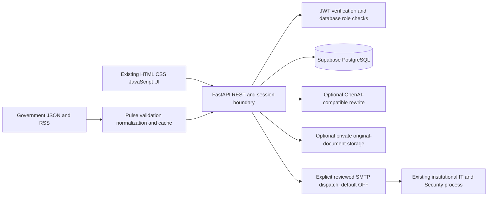

# Tech Stack, Tools and Architecture

## Verified stack and role

| Technology/tool | Verified role in this project | Environment/evidence limit |
|---|---|---|
| Python + FastAPI + Pydantic + Uvicorn | Backend logic, request validation, REST/OpenAPI and ASGI serving | README declares Python 3.10+; requirements are ranges, not a production version lock |
| SQLAlchemy 2 + psycopg2 + python-dotenv | ORM, parameterized SQL, PostgreSQL driver, sessions and private server configuration | Backend uses privileged DB connection; no DSN/secret values published |
| Supabase PostgreSQL + pg_trgm | Relational policies/users/roles/departments, versioned content, lexical search | Earlier Nov 23 read-only record confirms PostgreSQL 17.6, 7 departments, 3 roles, 12 users, 49 policies; retrieval accuracy is a separate measurement |
| HTML/CSS/vanilla JavaScript | Existing FastAPI-served `/ui/` shell, forms, roles, Library, Messages, Governance, Pulse | No React/Flask frontend, vector DB or frontend build tool is demonstrated |
| PyJWT, Supabase JWT/JWKS and browser-session code | Verified-token path, database-derived roles, cookie/session/origin/CSRF checks; signed loopback personas for development only | Real provider onboarding/production login and direct-client ACL/RLS acceptance unverified |
| OpenAI Python SDK, OpenAI-compatible Chat Completions | Optional context-grounded rewrite and optional incident classifier | Source defaults to OpenRouter; actual provider configuration/availability not verified here. Missing key/failure falls back; no embedding/vector search implemented |
| urllib/JSON/XML and government endpoints | Pulse collection, normalization, cache and provenance | Two JSON + two RSS sources; stale/error states preserved; no account/key required by this implementation |
| pypdf + defusedxml + bounded subprocess controls | PDF/DOCX text intake and resource limits; private-original handling | No OCR; local/native platform evidence does not establish every intended host |
| Python smtplib + ssl | Explicit, reviewed SMTP adapter, approved destinations, TLS and safe retry state | Default OFF. Tests inject mock transport; no background mail worker, Microsoft Graph integration or actual delivery proof |
| Git/GitHub; virtual environment; standalone Python/httpx + Node/Chrome CDP tests | Version control, isolated route/SQLite checks, real browser UI checks | SQLite is test infrastructure, not production datastore. Do not call mocked PostgreSQL syntax/ranking native PostgreSQL execution |
| Markdown/Mermaid; existing design artifacts | Project/runbook/report and diagram authoring | Documentation tools are not application services. No installed Mermaid renderer was found for this package |
| Jekyll/GitHub Pages | Separate portfolio/case-study publication | Not the host for the FastAPI backend or proof of production DeRexi deployment |

Declared runtime dependencies and inspected source support this inventory, not
speculation from the initial proposal. [S03 · README.md](../../derexi-policy-pilot/README.md) [S16 · requirements.txt](../../derexi-policy-pilot/requirements.txt) [S09 · models.py](../../derexi-policy-pilot/backend/models.py) [S10 · database.py](../../derexi-policy-pilot/backend/database.py) [S11 · ai.py](../../derexi-policy-pilot/backend/ai.py)
[S12 · sources.py](../../derexi-policy-pilot/backend/pulse/sources.py) [S13 · service.py](../../derexi-policy-pilot/backend/pulse/service.py) [S15 · document_intake.py](../../derexi-policy-pilot/backend/document_intake.py) [S31 · session_auth.py](../../derexi-policy-pilot/backend/session_auth.py) [S35 · deployment.md](../../derexi-policy-pilot/docs/deployment.md) [S37 · index.html](../../derexi-policy-pilot/backend/static/index.html)

## Component architecture

The UI calls the existing API; it does not hold database, SMTP or provider secrets.
The backend resolves identity/roles and scopes business operations before using
the privileged PostgreSQL connection. Optional provider and mail paths are separate
from policy storage. Missing optional services must not be presented as successful
delivery. The database remains necessary for normal policy assistance even when
the AI provider is disabled. [S06 · security.py](../../derexi-policy-pilot/backend/security.py) [S08 · incident_assistance.py](../../derexi-policy-pilot/backend/incident_assistance.py) [S10 · database.py](../../derexi-policy-pilot/backend/database.py) [S11 · ai.py](../../derexi-policy-pilot/backend/ai.py)

Core relational links are users→departments/roles, policies→owner/category,
policy_versions→policies and messages/clarifications/feedback→their authenticated
conversation participants. Drafts/review history and support/routing models exist
in source, but their declarations do not prove deployed tables. [S09 · models.py](../../derexi-policy-pilot/backend/models.py) [S20 · live-readonly-preflight.json](../../semester_5/DeRexi_Week%2011/evidence/final-integration-20261112/live-readonly-preflight.json) [S21 · live-readonly-20261123.json](../../postgresql_1/evidence/live-readonly-20261123.json) [S22 · database-design.md](../../semester_3/DeRexi_Week%203/database-design.md)

## Original proposals that must not be counted as implemented

The Aug 13 design lists Flask or FastAPI, SQLite or future PostgreSQL, ChromaDB or
FAISS, PDF extraction alternatives, SMTP or Microsoft Graph, and possible Entra ID.
The current build chose FastAPI/PostgreSQL and lexical pg_trgm, pypdf/defusedxml,
JWT/session code and a default-OFF SMTP adapter. Figma/draw.io/VS Code are named in
planning material; their specific use to author a given DeRexi artifact is not
independently proved here. No current Entra/Graph/vector-store implementation is
claimed just because it was discussed. [S01 · EDU_Project_Design_Doc_Final V.1.docx](../../semester_2/EDU_Project_Design_Doc_Final%20V.1.docx)

The actual catalog also shows schema drift: roles.created_at has a unique constraint
absent from the ORM declaration, and users.job_title required by a pending seed is
not present in the Nov 23 core catalog. No correction is performed. [S40 · README.md](../../postgresql_1/Assignment_2_Schema_Design/README.md)

[Editable architecture diagram](architecture.mmd).

---

**Document review:** 2026-11-23. [Master design](../assignment_01_design_document/DELIVERABLE.md) · [Evidence map](../EVIDENCE_MAP.md).
