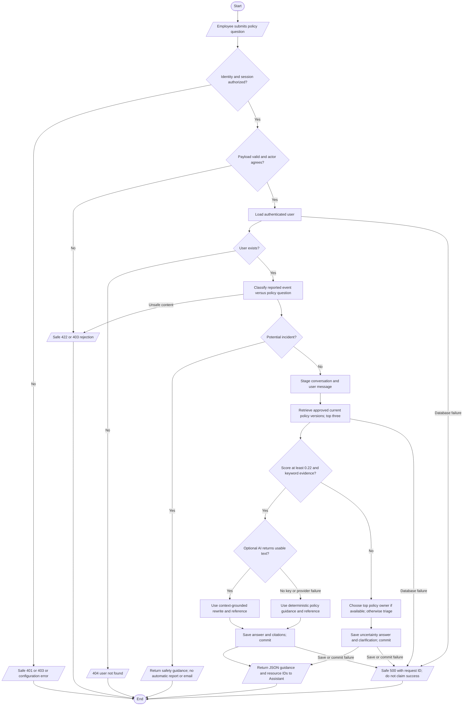

# Policy-Assistance Flowchart

## Notation and scope

The flowchart follows the high-level algorithm in Assignment 08. Rounded stadiums
are start/end; rectangles are processes; parallelograms are input/output; diamonds
are decisions. Explicit branches cover authentication, validation, actual incidents,
insufficient evidence, provider failure/fallback and database/save errors.

The incident output leads to the separately reviewed support workflow, not an
automatic report/email. A provider failure takes the deterministic-guidance path;
it is not treated as a confident generated answer. The 500 path does not imply
every ambiguous commit was undone. [S04 · main.py](../../derexi-policy-pilot/backend/main.py) [S05 · schemas.py](../../derexi-policy-pilot/backend/schemas.py) [S06 · security.py](../../derexi-policy-pilot/backend/security.py) [S08 · incident_assistance.py](../../derexi-policy-pilot/backend/incident_assistance.py) [S10 · database.py](../../derexi-policy-pilot/backend/database.py) [S11 · ai.py](../../derexi-policy-pilot/backend/ai.py)

## Editable source and validation

`policy-assistance.mmd` is the exact editable source embedded above. Local checks
verify the documented node/edge subset, declared-node references, all four shape
types, branch labels and path reachability. Those checks are **not** an official
Mermaid parser or a new workflow test.

No installed `mmdc`, local Mermaid package, Graphviz or Mermaid VS Code extension
was found. Therefore no PNG/SVG rendering is fabricated or claimed. The editable
Mermaid and embedded diagram are supplied for a Mermaid-capable Markdown viewer;
image export remains an optional tooling gap. No package/network renderer was
installed or invoked. Source/code alignment is checked offline.

[Editable workflow diagram](policy-assistance.mmd).

---

**Document review:** 2026-11-23. [Master design](../assignment_01_design_document/DELIVERABLE.md) · [Evidence map](../EVIDENCE_MAP.md).
